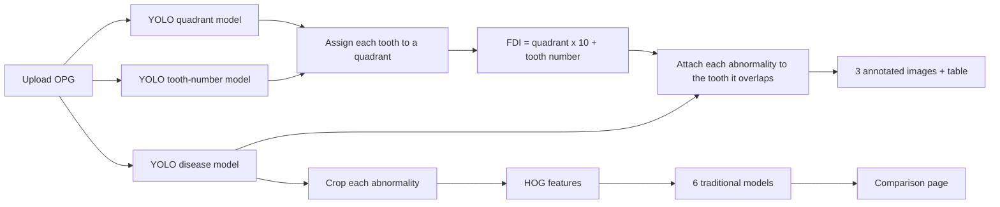

# Dental OPG Analyzer: Tooth Detection, FDI Numbering and Abnormality Detection on Panoramic X-rays
 
An end-to-end project on the **DENTEX** dataset. Given a panoramic dental X-ray (OPG), the system
1. divides the jaw into its **4 quadrants**,
2. finds every tooth and gives it its **FDI number**,
3. finds the **abnormalities** (Caries, Deep Caries, Periapical Lesion, Impacted tooth),
and compares what **six traditional machine-learning models** (Logistic Regression, Ridge, Random Forest, SVM, KNN, Decision Tree) predict for the same abnormalities. A **Voting Classifier** that combines four of these models into one soft-voting ensemble is also trained and evaluated (Part B). Everything is served through a web app.
 
> **Disclaimer.** This is an academic / research project. It is **not** a medical device and must not be used for diagnosis or treatment decisions.
 
---
 
## Table of contents
1. [Project overview](#1-project-overview)
2. [Dataset](#2-dataset)
3. [Repository structure](#3-repository-structure)
4. [Key concepts](#4-key-concepts)
5. [Part A: YOLO detection](#5-part-a-yolo-detection)
6. [Part B: Traditional ML models](#6-part-b-traditional-ml-models)
7. [Results](#7-results)
8. [Part C: Web application](#8-part-c-web-application)
9. [Limitations and future work](#9-limitations-and-future-work)
10. [Reproducibility](#10-reproducibility)
---
 
## 1. Project overview
 
The project has three parts that share one dataset:
 
| Part | What it does | Where |
|---|---|---|
| **A. YOLO** | Locates quadrants, teeth (with tooth number) and abnormalities on the full X-ray | `YOLO.ipynb` |
| **B. Traditional ML** | Classifies a cropped tooth / region with HOG features and six classical models, plus a soft-voting ensemble (Voting Classifier) of four of them | the six model notebooks and `VotingClassifier.ipynb` in the repo root |
| **C. Web app** | Upload an OPG, see the three annotated images, and compare the traditional models | `dental_ai/` |
 
### Objectives
 
| # | Objective | Done by |
|---|---|---|
| 01 | **Tooth localization**: locate individual teeth / quadrants in an OPG | YOLO (Part A) |
| 02 | **Quadrant prediction and tooth enumeration**: classify a tooth into one of four quadrants and give its number | YOLO (Part A) and traditional models incl. Voting Classifier (Part B) |
| 04 | **Pathology detection**: identify caries, deep caries, periapical lesions and impacted teeth | YOLO (Part A) and traditional models incl. Voting Classifier (Part B) |
 
### Pipeline
 

 
---
 
## 2. Dataset
 
**DENTEX** (Dental Enumeration and Diagnosis on Panoramic X-rays), from the MICCAI 2023 challenge. The training data is downloaded from the Hugging Face dataset `keycxl/DENTEX` (`DENTEX/training_data.zip`). 
 
| Subset | Images | Annotations | Labels |
|---|---|---|---|
| `quadrant` | 693 | 2,772 quadrant regions | quadrant (1 to 4) |
| `quadrant_enumeration` | 634 | 18,095 teeth | quadrant + tooth number (1 to 8) |
| `quadrant-enumeration-disease` | 705 | 3,529 abnormal teeth | quadrant + tooth number + abnormality |
| `unlabelled` | 1,571 | none | not used |
 
Things worth knowing about the data:
- Annotations are in **COCO format** (`bbox` plus polygon `segmentation`). Category ids are **not** the quadrant numbers, so names must always be mapped through the `categories` lists.
- The disease file has **no healthy class**. Only abnormal teeth are annotated, about 5 per X-ray against roughly 28 teeth in a full mouth. A classifier trained on it can say *which* abnormality a tooth has, not *whether* it is healthy.
- The four abnormality classes are heavily **imbalanced**:
| Abnormality | Teeth | Share |
|---|---|---|
| Caries | 2,189 | 62% |
| Impacted | 604 | 17% |
| Deep Caries | 578 | 16% |
| Periapical Lesion | 158 | 4% |
 
- The official DENTEX challenge test set has no public labels and is **not used**. All evaluation here uses held-out parts of the labelled training data, always split **by X-ray**.
---
 
## 3. Repository structure
 
```
Dentex/
├── README.md
├── YOLO.ipynb                                       
├── KNN.ipynb                                        
├── RandomForest.ipynb                           
├── SVM.ipynb                                        
├── DecisionTrees.ipynb                              
├── VotingClassifier.ipynb                           
├── LogisticRegression.ipynb         
├── RidgeClassifier.ipynb        
├── .gitignore                                       
└── dental_ai/                                       
    ├── run.py   config.py   requirements.txt   train_classical.py
    ├── models/
    │   ├── quadrant.pt  enum.pt  disease.pt         
    │   ├── imgsz.txt                                
    │   └── classical/classical_models.joblib        
    ├── app/
    │   ├── main.py                                  
    │   └── services/
    │       ├── yolo_engine.py    mock_engine.py     postprocess.py
    │       ├── annotate.py       classical.py
    ├── static/   index.html  compare.html  style.css
    ├── storage/results/                             
    └── tests/test_api.py
```
 
Model weights and `.joblib` files are large binaries. They are excluded by `.gitignore`.Can refer to them from the YOLO.ipynb file.
 
---
 
## 4. Key concepts
 
**OPG (orthopantomogram).** A panoramic X-ray of both jaws. By convention the **patient's right side appears on the left of the image**.
 
**Quadrants.** The mouth is divided into four: 1 = upper right, 2 = upper left, 3 = lower left, 4 = lower right (patient's point of view).
 
**FDI notation.** A tooth is named with two digits: *quadrant* then *tooth number*. Tooth numbers run 1 (central incisor), 2 (lateral incisor), 3 (canine), 4 and 5 (premolars), 6 to 8 (molars, 8 = wisdom tooth). Tooth 36 is therefore the first molar of the lower-left quadrant. There are 32 valid numbers (11 to 18, 21 to 28, 31 to 38, 41 to 48).
 
**Abnormalities.**
- *Caries*: tooth decay.
- *Deep caries*: decay that has reached close to the pulp.
- *Periapical lesion*: inflammation at the root tip, seen as a dark area around the apex.
- *Impacted tooth*: a tooth that cannot erupt normally, most often a wisdom tooth.
**Object detection (YOLO).** A neural network that finds objects on the whole image and returns a bounding box, a class and a confidence for each. Used here because traditional models cannot find teeth by themselves; they can only classify a crop that is already given.
 
**HOG (Histogram of Oriented Gradients).** A hand-crafted feature that describes the shape and edge directions inside an image patch. A crop is divided into small cells, the gradient directions in each cell are counted, and the counts form a feature vector. It is the input of all traditional models here.
 
**CLAHE / autocontrast.** Contrast enhancement applied to each crop before HOG, because dental X-rays have low and uneven contrast.
 
**Position features.** The normalized centre and size of a box on the X-ray. Quadrant and tooth number depend strongly on *where* a tooth is, which appearance alone cannot tell (a tooth and its mirror image look alike).
 
**Class imbalance.** Caries is 62% of the abnormal teeth. Models are therefore evaluated with macro-averaged metrics, and `class_weight="balanced"` is used where the algorithm supports it (KNN has no such option).
 
**Hyperparameter tuning.** `GridSearchCV` with `scoring="f1_macro"` is run on the training part only; the test part is used once at the end. The Voting Classifier is the exception: it is not searched again and simply reuses the best settings of its member models.
 
**Voting classifier (ensemble).** A meta-model that trains several different models on the same data and combines their outputs into one prediction. With **hard voting** each model casts one vote for a class and the majority wins. With **soft voting** (used here) each model's predicted class *probabilities* are averaged and the class with the highest average wins. The idea is that models make different mistakes, so combining them can be more stable than any single one. Soft voting needs every member to output probabilities.
 
**Macro-averaged metrics.** Precision, recall and F1 are computed per class and averaged with equal weight, so rare classes count as much as common ones. Accuracy alone is misleading on imbalanced data (always guessing "Caries" would score about 62%).
 
**Hierarchical FDI.** For the webpage which is built upon using the results from YOLO,instead of one 32-class model, predict the quadrant first (about 97 to 99% accurate), then choose the tooth number among 8 candidates: `FDI = quadrant x 10 + tooth number`.
 
---
 
## 5. Part A: YOLO detection
 
`YOLO.ipynb` trains **three separate YOLOv8 models** with Ultralytics, one per task:
 
| Model | Detects | Classes |
|---|---|---|
| `quadrant` | the 4 quadrant regions | 1, 2, 3, 4 |
| `enum` | individual teeth with their tooth number | 1 to 8 |
| `disease` | abnormal teeth | Impacted, Caries, Periapical Lesion, Deep Caries |
 
**Pipeline in the notebook**
1. Download DENTEX from Hugging Face and extract it.
2. Convert the COCO annotations (polygons or boxes) to YOLO label format, one dataset per task.
3. Split **by image** into train / validation / test (seed 42), so no X-ray appears in two sets.
4. Train each model, then evaluate on the held-out images.
**Training settings** (verify against the notebook before publishing): YOLOv8s, 50 epochs, image size 1024, batch 4, seed 42, **horizontal flip disabled** (`fliplr=0.0`). Flipping an OPG swaps the patient's left and right and would corrupt the quadrant and FDI labels.
 
**How FDI is produced from three models.** The tooth-number model only gives 1 to 8. Each detected tooth is assigned to the quadrant box that contains most of it , and `FDI = quadrant x 10 + tooth number`. If two boxes get the same FDI number, only the most confident is kept. Each abnormality box is attached to the tooth it overlaps most (at least 30% of the abnormality box must lie inside the tooth).
 
---
 
## 6. Part B: Traditional ML models
 
Traditional models cannot localize anything. They classify an **already cropped** region (a quadrant region, a tooth, or an abnormal tooth) from its HOG features. All six follow the same experimental protocol so the comparison is fair. The **Voting Classifier** (see 6.5) uses the same data, features and 70/30 split, but combines already-tuned models instead of being tuned itself.
 
### 6.1 Three tasks
 
| Task | Crops come from | Target | Classes |
|---|---|---|---|
| **Quadrant** | `quadrant` subset (2,772 regions) | quadrant | 4 |
| **Tooth numbering** | `quadrant_enumeration` (18,095 teeth) | tooth number 1 to 8 (FDI = quadrant x 10 + tooth number) | 8 |
| **Abnormality** | `quadrant-enumeration-disease` (3,529 teeth) | abnormality type | 4 |
 
### 6.2 Shared protocol
1. Read the COCO JSON, map category ids to names, build a table of boxes and labels.
2. Crop each box from the X-ray, enhance contrast, resize, and extract **HOG** features.
3. Split with `GroupShuffleSplit(test_size=0.3, random_state=42)` grouped by X-ray file.
4. Tune with `StratifiedGroupKFold` + `GridSearchCV(scoring="f1_macro")` on the training part. *(The Voting Classifier skips this step and reuses its members' best settings.)*
5. Evaluate once on the held-out 30%: accuracy, macro precision, macro recall, macro F1, confusion matrix.
6. For the web page the best models are saved with `joblib` and imported.
### 6.3 Models and search grids
 
| Model | Pipeline | Searched hyperparameters | Notes |
|---|---|---|---|
| **KNN** | `StandardScaler` > `PCA` > `KNeighborsClassifier` | PCA components {0.90, 0.95}; k {3, 5, 9} | Distance-based; PCA reduces the ~1,800 HOG features. No `class_weight` option. |
| **Random Forest** | `RandomForestClassifier(class_weight="balanced")` | `n_estimators` {200, 400}; `max_depth` {None, 20} | Handles the position columns without scaling. |
| **Logistic Regression** | `StandardScaler` > `LogisticRegression` | `C` {0.005, 0.01, 0.1, 1, 10}; `max_iter` {100, 150, 300, 500, 1000, 2000} | `class_weight="balanced"` for the abnormality task. Strong L2 regularization (small C) wins. |
| **Ridge** | `StandardScaler` > `RidgeClassifier(solver="lsqr")` | `alpha` {1 ... 100000}; `max_iter` {50, 200, 1000} | `RidgeClassifier` is the classification form of ridge regression (it regresses on class targets). `class_weight="balanced"` for abnormality. |
| **SVM** | `StandardScaler` > `PCA` > `SVC` | same structure as the KNN / RF notebooks | See `SVM.ipynb`. |
| **Decision Tree** | `DecisionTreeClassifier(class_weight="balanced")` | same structure as the KNN / RF notebooks | See `Decision_Tree.ipynb`. |
| **Voting Classifier** | `VotingClassifier(voting="soft")` over four pipelines: Logistic Regression, SVM (`probability=True`), Random Forest, KNN | none (no grid search; members use the best settings in 6.4, equal weights) | See `VotingClassifier.ipynb` and section 6.5. Ridge and Decision Tree are not members (Ridge has no probability output, which soft voting needs). |
 
### 6.4 Best hyperparameters found
 
| Model | Quadrant | Tooth numbering | Abnormality |
|---|---|---|---|
| KNN | k=9, PCA 0.90 | k=9, PCA 0.95 | k=3, PCA 0.90 |
| Random Forest | 400 trees, depth None | 400 trees, depth 20 | 200 trees, depth 20 |
| Logistic Regression | C=0.01, max_iter=150 | C=0.005, max_iter=150 | C=0.005, max_iter=150 |
| Ridge | alpha=100, max_iter=50 | alpha=1000, max_iter=50 | alpha=1000, max_iter=50 |
| SVM (RBF) | C=1, gamma="scale", PCA 0.95 | C=1, gamma="scale", PCA 0.95 | C=1,gamma="scale", PCA 0.95 |
| Decision Tree | criterion=entropy, max_depth=None, max_features=None, min_samples_leaf=5, min_samples_split=2 | criterion=entropy, max_depth=10, min_samples_leaf=5, min_samples_split=2 | criterion=entropy, max_depth=20, min_samples_leaf=5, min_samples_split=2 | 
| Voting Classifier | not searched: soft voting of the Logistic Regression, SVM, Random Forest and KNN settings above | same | same |
For Logistic Regression and Ridge several settings tie exactly (for example every `max_iter` gives the same score), which means the solver converges well before the iteration cap and `max_iter` is not an influential choice here. Some best values sit at the **edge of their grid** (for example the smallest `C`, the smallest `max_iter`), so a wider grid might help slightly.
 
### 6.5 Voting Classifier
 
`VotingClassifier.ipynb` builds an ensemble from four of the models above and checks whether combining them beats the individual models.
 
**Members** (the same pipelines and best settings as in 6.4, one set per task):
 
| Member | Pipeline | `class_weight` |
|---|---|---|
| Logistic Regression | `StandardScaler` > `LogisticRegression` | balanced |
| SVM (RBF) | `StandardScaler` > `PCA(0.95)` > `SVC(probability=True)` | balanced |
| Random Forest | `RandomForestClassifier` | balanced |
| KNN | `StandardScaler` > `PCA` > `KNeighborsClassifier` | not available |
 
**How it works**
1. Build the HOG + position features exactly as in 6.2 (64 x 64 crop, CLAHE, 9 orientations, 8 x 8 pixel cells, 2 x 2 blocks: 1,764 HOG values + 4 position values = 1,768 features per crop).
2. Split with `GroupShuffleSplit(test_size=0.3, random_state=42)` grouped by X-ray (`image_id`). Train / test sizes: quadrant 1,940 / 832, tooth numbering 12,610 / 5,485, abnormality 2,468 / 1,061. The test image ids of each task are saved to `test_ids_<task>.csv`.
3. Fit `VotingClassifier(members, voting="soft")` on the training part of each task. Each member is trained on the same data, and at prediction time the four class-probability vectors are averaged (equal weights).
4. Evaluate once on the held-out 30%: accuracy, macro precision, macro recall, macro F1, a row-normalized confusion matrix and a per-class report for each task. The scores are saved to `classical_results.csv`.
 
Soft voting needs probabilities from every member, which is why `SVC` is created with `probability=True` (it internally calibrates the SVM scores, so fitting is slower). Ridge cannot provide probabilities and is therefore left out.
 
---
 
## 7. Results
 
 
### 7.1 What the results show
- **Quadrant is almost solved** (above 99% for the linear models and for the Voting Classifier, 0.995). The label is closely tied to where the region sits on the image, so it is largely a position problem. Perfect scores on a 832-region test set should be read with that in mind.
- **Tooth numbering is the hard part** (about 0.58 to 0.59 accuracy for the linear models, 0.604 for the Voting Classifier). The confusion matrices show errors **between neighbouring numbers** (1 vs 2, 4 vs 5, 6 vs 7 vs 8), because adjacent teeth look alike. Voting is slightly better than the linear models here, but it is not a breakthrough: the wisdom tooth (8) is the easiest class (F1 0.74) and tooth 2 the hardest (F1 0.51).
- **Abnormality detection is weak on the rare classes.** The models mostly separate *Caries* and *Impacted* and confuse *Deep Caries* and *Periapical Lesion* with Caries. Periapical Lesion has only 158 examples in total, so its metrics are noisy. The Voting Classifier shows this clearly: it finds 97% of Caries but only 12% of Deep Caries and 4% of Periapical Lesion.
- **Accuracy and macro-F1 disagree** on the abnormality task (accuracy about 0.64, macro-F1 about 0.56 for the linear models), which is why macro metrics are reported. The gap is even larger for the Voting Classifier (accuracy 0.767 but macro-F1 0.493): its higher accuracy comes from predicting the majority class *Caries* more often, not from better rare-class detection. A likely reason is that the averaged probabilities are not balanced for KNN and for the SVM's calibrated outputs, so the ensemble leans to the common class; this was not tested separately.
- **The ensemble does not clearly beat the best single model.** It helps a little on tooth numbering and matches the others on quadrant, but on the abnormality task a higher accuracy is paired with a lower macro-F1, so which model is "best" depends on the metric that matters.
---
 
## 8. Part C: Web application
 
A FastAPI backend with a plain HTML/CSS/JavaScript frontend (no external libraries or CDN).
 
### 8.1 Pages
1. **YOLO analysis (`/`)**: upload an OPG. Three tabs show the same X-ray with:
   1. the 4 quadrants,
   2. the FDI number of each tooth,
   3. the abnormalities with FDI, type and confidence.
   A side panel lists the findings and counts. Images open full size on click and can be downloaded.
2. **Traditional models (`/compare`)**: every abnormality found by YOLO is cropped and passed to the six classical models. Each finding gets a card with the crop, YOLO's label, and each model's prediction (green outline = agrees with YOLO), plus per-model agreement bars and the held-out test scores from training. YOLO is the **reference, not ground truth**.
### 8.2 Setup
 
```bash
cd dental_ai
pip install -r requirements.txt
```
 
Place the weights:
 
```
dental_ai/models/quadrant.pt
dental_ai/models/enum.pt
dental_ai/models/disease.pt
dental_ai/models/classical/classical_models.joblib      
dental_ai/models/imgsz.txt                              
```
 
- Copy each YOLO run's `weights/best.pt` and rename it as above. 
- Create `classical_models.joblib` by running `python train_classical.py <dataset folder>` (it trains all six models on the abnormality task and also stores their test metrics). Install the **same scikit-learn version** that trained it, otherwise loading can fail.
### 8.3 Run
 
```bash
python run.py                  
```
 
The app checks for the three `.pt` files at startup:
- **All present:** real YOLO inference.
- **Any missing:** **demo mode** with simulated boxes and a visible warning banner. The boxes in demo mode do not follow the X-ray.
- Override with `USE_MOCK=1` (force demo) or `USE_MOCK=0` (force real).
Run the tests (they use the demo detector and a tiny dummy classical model):
 
```bash
pytest
```
 
### 8.4 API
 
| Method | Route | Purpose |
|---|---|---|
| `GET` | `/` | YOLO analysis page |
| `GET` | `/compare` | Traditional-models page |
| `GET` | `/api/health` | Status: demo mode, classical models loaded, colours |
| `POST` | `/api/analyze` | Upload an image (`file`); returns teeth, FDI, findings, image URLs, comparison |
| `GET` | `/api/results/{id}` | Saved result of an earlier analysis |
 
Each analysis is stored in `storage/results/<id>/` (original, three annotated images, crops, `result.json`).
 
### 8.5 How the backend is organized
 
| File | Role |
|---|---|
| `app/services/yolo_engine.py` | Loads the three YOLO models and runs them at the training image size |
| `app/services/mock_engine.py` | Demo detector used when weights are missing |
| `app/services/postprocess.py` | Tooth to quadrant assignment, FDI numbers, duplicate removal, linking abnormalities to teeth, summary counts |
| `app/services/annotate.py` | Draws the three annotated images |
| `app/services/classical.py` | Same HOG + position features as training, then predictions from the six models |
| `config.py` | Paths, confidence thresholds, image size, class colours |
 
 
 
---
 
## 9. Limitations and future work
 
- **Rare abnormalities** (Deep Caries, Periapical Lesion) are poorly separated by HOG + classical models. Small crops and hand-crafted features hold little information about lesion depth.
- **No healthy class.** The disease annotations contain only abnormal teeth. A "probably healthy" class could be derived from teeth listed in the enumeration data but absent from the disease data, with the caveat that some of them have untagged disease or restorations.
- **Ground-truth inputs.** Several classical experiments use the true quadrant or tooth number as input. End-to-end performance with predicted values will be lower.
- **Detection recall.** The comparison page only sees abnormalities that YOLO finds; anything YOLO misses is not classified.
- **Dataset size.** Few examples for the rare classes make their metrics unstable between folds.
- **Small, single-source data.** Results may not transfer to other X-ray machines or populations.
- **Voting Classifier is not tuned as an ensemble.** It reuses the members' best settings, uses equal weights, and leaves out Ridge and Decision Tree. Because the members were tuned on their own, the combination is not necessarily the best one. It also inherits the class-imbalance problem (KNN has no `class_weight`, and the averaged probabilities favour Caries), and training is slower because of the probability-enabled SVM.
- Ideas: tooth-context features (rank from the midline within a quadrant), wider hyperparameter grids where best values sit at an edge, oversampling inside cross-validation folds for rare classes, CNN classifiers on the crops, semi-supervised use of the 1,571 unlabelled images, and nested cross-validation for fully unbiased tuning. For the ensemble: weighted voting (higher weight for the better members), tuning the voting weights with cross-validation, adjusting the averaged probabilities for class priors or a decision threshold for the rare classes, and stacking (a small model that learns how to combine the members).
---
 
## 10. Reproducibility
 
- Random seed **42** everywhere (splits, models).
- Splits are always by X-ray, never by crop.
- Tuning uses the training part only; the held-out part is evaluated once.
- Colab sessions are wiped on disconnect. Save weights and `.joblib` files outside `/content` as soon as training ends.
---
 
